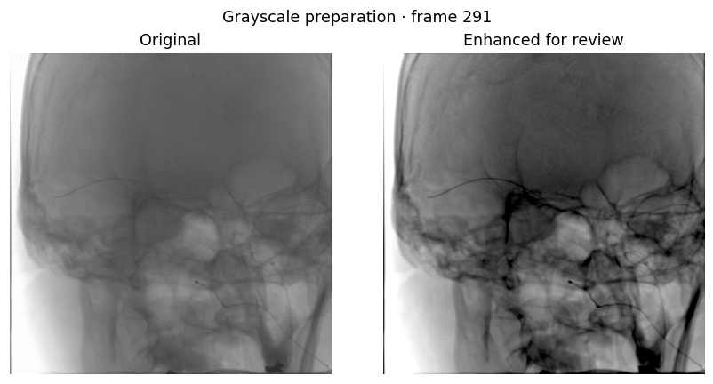
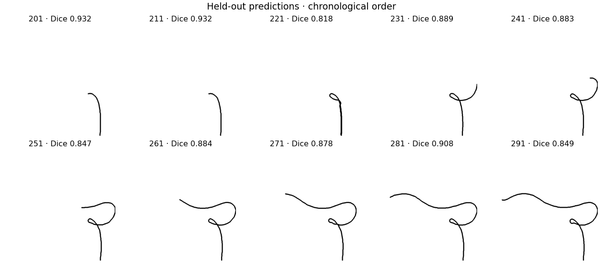
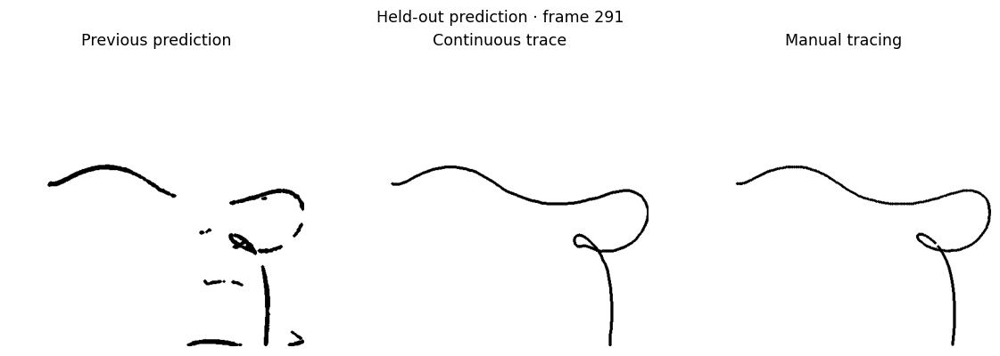

# Segmenting guidewires and microcatheters in fluoroscopy

**Denos Kume and Oluwole Shokunbi · MSc Control and Robotics · Centrale Nantes**

[Open the interactive portfolio case study](https://denoskume.github.io/portfolio/#/projects/fluoroscopy-instrument-segmentation) · [Read the executed notebook](Fluoroscopy_Instrument_Segmentation.ipynb)

The interactive review is integrated into the standalone portfolio. It displays the frame comparisons and supports review notes and CSV export.

## Retrospective imaging review

This project models a hospital imaging research team’s offline review of a teaching acquisition. A technical reviewer checks the input pairs and run provenance. An imaging reader can then inspect all ten frames in chronological order and document visibility, missed tool segments and false detections. Clinical review is pending. The dataset contains exported images and tracings; patient-level outcomes and acquisition geometry are unavailable.

Open the **[integrated frame reviewer](https://denoskume.github.io/portfolio/#/projects/fluoroscopy-instrument-segmentation)** in a browser. Enter your findings beside each frame. Drafts are stored in the current browser when available. Select **Export worksheet (CSV)** to download all ten rows. A [blank worksheet](review/reader_template.csv) is also included. The [run manifest](review/run_manifest.json) identifies the inputs, parameters, software versions and output masks.

## Grayscale preparation

All ten images use the same display window, local contrast enhancement and gamma correction before rendering overlays. The case study includes the original and enhanced views side by side.



## Mission

Detect thin, moving instruments against noisy anatomical structures in a fluoroscopic sequence. We compared three segmentation methods on a common background-subtraction pipeline, checked each prediction against manual guidewire and microcatheter tracings, and used the errors to explain where the pipeline breaks down.

[Read the executed Python notebook](Fluoroscopy_Instrument_Segmentation.ipynb)



## Continuous instrument tracing

The classical background-subtraction pipeline sometimes loses the stationary shaft and picks up anatomical edges. The supervised extension uses an oriented dark-line response, local intensity derivatives and temporal change to estimate pixel scores, then decodes one connected centerline from the lower image border. This is a projection-specific assumption.

This is a retrospective, within-acquisition experiment. The new supervised method fits on other manually traced frames from the same acquisition. Each test pair and its immediate neighbors are excluded from fitting. The temporal background uses the raw images of the whole sequence. Model and path settings were explored on this sequence; the scores are development results, not independent patient-level validation.

On the nine motion frames, mean Dice rose from **0.501 to 0.876**. False-positive pixels fell from 22,472 to 3,553 and missed pixels from 5,240 to 2,511. All ten predictions formed a single component. Frame-level Dice ranged from 0.818 to 0.932. Inspect the [per-frame comparison](frame_comparison.csv) and the review overlays for residual errors.



## Segmentation results before component cleanup

Each entry is a mean over the same nine subsequent frames. Instrument pixels are a small part of the image, so foreground Dice and IoU accompany whole-mask PSNR.

| Segmentation method | Mean Dice | Mean IoU | Mean PSNR |
|---|---:|---:|---:|
| Fixed threshold (0.10) | **0.416** | 0.280 | **16.57 dB** |
| Otsu threshold | 0.412 | **0.295** | 13.95 dB |
| Two-component Gaussian mixture | 0.385 | 0.249 | 15.30 dB |

We retained the fixed threshold for its foreground Dice and PSNR. The Dice difference from Otsu is small, and the two methods rank differently on IoU. The methods were selected and evaluated on one acquisition; these scores describe that sequence.

## What changed the result?

- **Background subtraction alone** produced a mean PSNR of 20.35 dB and a Dice of just 0.001. Predicting mostly background can give a favorable pixel-error score while missing almost the entire tool.
- **Contrast stretching and smoothing** brought Dice to 0.199 after stretching and 0.387 after spatial Gaussian filtering. Adding a frequency-domain low-pass filter raised it to 0.403.
- **Morphological processing** raised Dice to 0.416 and reduced PSNR from 17.22 to 16.57 dB. Expanding and cleaning the response traded some whole-image agreement for improved instrument overlap.

## Experience gained

Designed a stepwise comparison of image-processing choices, converted two manual tracings into a shared reference mask, and diagnosed failures using per-frame metrics and overlays. The notebook includes descriptive Python functions for preprocessing, inference and evaluation so each step can be inspected or rerun.

## Reproduce the analysis

Extract the project and keep `catheter.zip` beside the notebook. From the project directory, use a Python 3.12 environment and run:

```bash
python -m pip install -r requirements.txt
python -m jupyter lab Fluoroscopy_Instrument_Segmentation.ipynb
```

Choose **Restart Kernel and Run All Cells**. The dataset contains ten 512 × 512 frames and twenty annotations. Frame 201 is the fixed reference. The notebook regenerates all ten PNGs in `output_masks/`, verifies their pixel values, and reports sequence statistics including the reference. Each exported mask uses 0 for instruments and 1 for background.

**Academic context.** Adapted from the Background Subtraction practical by Diana Mateus at Centrale Nantes, using the supplied fluoroscopy sequence and manual annotations.
